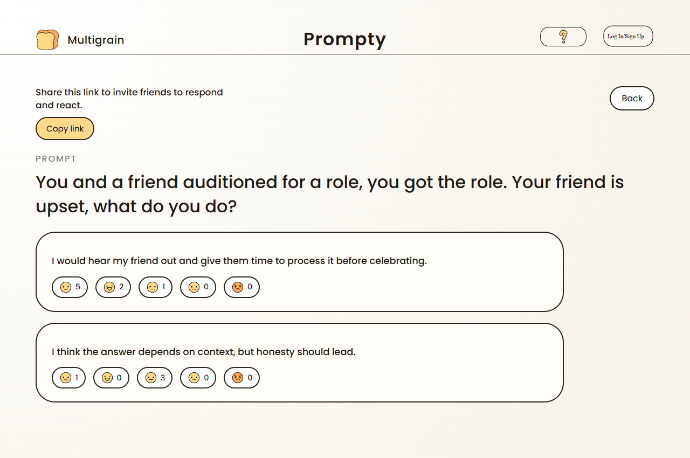

# Prompty

Prompty is a React and TypeScript prototype for starting a conversation around a prompt. Choose a moral, creative, or AI skill development prompt, write a response, and react to it or to an example response.



*Screenshot from an earlier prototype build. The current version has disabled help and sign-in controls and no share button.*

## My contributions

I’m Justin Hoang (@Kiekeku). I built the initial React layout from our [design references](references), integrated the custom icons, and implemented the flow from choosing a prompt to writing a response and reacting to it. The interaction logic is in [`src/App.tsx`](src/App.tsx), and the prompts are in [`src/content/sections.json`](src/content/sections.json).

## Run locally

Use Node.js 22.12 or newer.

```bash
npm ci
npm run dev
```

Open the local URL printed by Vite. Run `npm run lint` to check the source and `npm run build` to type-check and create a production bundle.

## Prototype scope

Responses and reactions stay in the current tab and reset on reload. Help and sign-in are disabled in the prototype. The app has no shared sessions.
